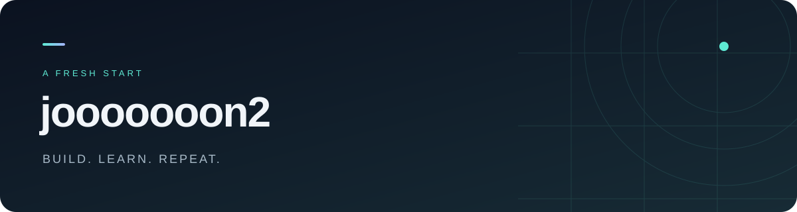

 

**배우고, 만들고, 개선합니다.**

작게 시작하고, 꾸준히 쌓아갑니다.

 

[프로젝트 보기](https://github.com/jooooooon2/angmu-website) · [코드 둘러보기](https://github.com/jooooooon2?tab=repositories)

 

### Project

<a href="https://github.com/jooooooon2/angmu-website"><strong>angmu-website ↗</strong></a>

프로젝트의 코드와 변경 내역을 확인할 수 있습니다.

 

---

하나씩 만들고, 한 걸음씩 앞으로.

